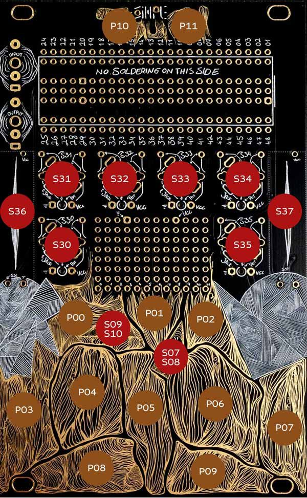

# Ceres
Ceres is a polytrillic synthesizer where you summon alternating tones that morph into extraterrestrial soundscapes. Inspired by a mysterious 1989 audio tape recorded during a crop circle investigation, [Operation White Crow](https://www.colinandrews.net/CheesefootHead-PatDelgado.html), at Cheesefoot Head in England, Ceres can emulate the described recording and can ascend into chaotic, exploratory, and alien-like dimensions.

Built for the [Synthux Simple Touch 2](https://www.synthux.academy/store/simple-touch-2) during the Synthux Academy Residency 2026-2027 (Cohort 2).

Faceplate comming soon...

## VIDEO
[](https://www.youtube.com/watch?v=WhIm2kJVOp4)

## QUICK INSTALL
Download the [Binary file](https://github.com/chrisades/Ceres/releases/latest/download/Ceres.bin) and flash using the [Daisy Seed web programmer](https://flash.daisy.audio/)

## CONTROLS


**Switches**
- S07-S08 - Modulation Mode (Trill-Morph | Rand-Steps | Chaos)
- S09-S10 - Morph Mode (Reso | Square | C-saw)

**Knobs**
- S30 - Tone-A
- S31 - Span-A
- S32 - Mix
- S33 - Speed
- S34 - Span-B
- S35 - Tone-B
- S36 - Modulation Depth
- S37 - Morph Amount

**Pads**
- P00 - Modulation-Invert
- P01 - Hold
- P02 - Tone-Swap
- P03...P09 - Trill Activators
- P10 - Fractalize
- P11 - Ascend

<!-- ## MANUAL
**Trill Voice**
A trill consists of two tones, A and B.....
Tone-Swap

**Morphing**
There are three morph modes that can be selected with (S09-S10)
- Reso: Simulated resonant filter sweep
- Square: Sine to Square
- Csaw: Saw-like

**Modulation**
There are three modulation routings that can be selected with (S07-S08)
- Trill-Morph: The trill envelopes modulate the morph amount of each tone
- Rand-Step: Each tone is transposed 
- Chaos: 
Modulation-Invert momentarily glides the modulation depth to its inverse

**Fractalize**
- Momentarily introduces a dual delay line and conditional tone triggering based on the first bits of the respective runglers.
- Speed (S33) controls the the delay times
- Mix (S32) controls the feedback levels

**Ascend**
- Momentarily mixes each trill voice into dual bandpass filters over white noise. The XOR output of the two tones is slightly present.
- Tone-A (S30) and Tone-B (S35) control the center frequency of each bandpass
- Span-A (S31) and Span-B (S34) control the widths of each bandpass -->

## PREREQUISITES
- [Daisy Toolchain](https://docs.daisy.audio/tutorials/cpp-dev-env/) (ARM GCC + make)
- **Windows:** use [Git Bash](https://git-scm.com/downloads) to run the commands below

## Project Setup
```shell
$ git clone --recurse-submodules https://github.com/chrisades/Ceres.git
$ make libs -j8
$ make clean; make -j8
```

If you already have the repo cloned without submodules, run this first:
```shell
$ git submodule update --init --recursive
```

## UPLOAD
```shell
$ make program-dfu
```

> [!NOTE]
> When tweaking code, run `make clean && make` for a full rebuild, or just `make` for an incremental rebuild (only recompiles changed files). The compiled binary is placed in the `build/` folder as `ZoscTouch.bin`.